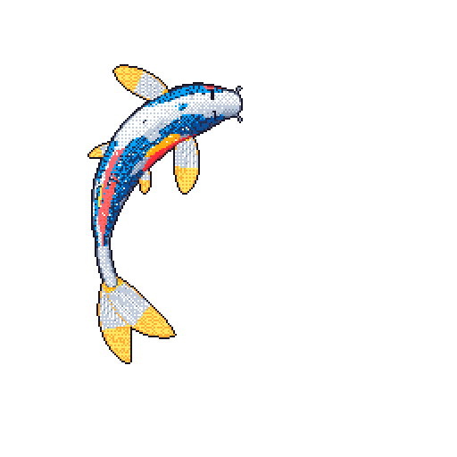
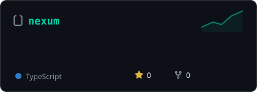
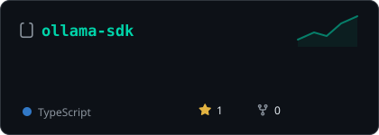
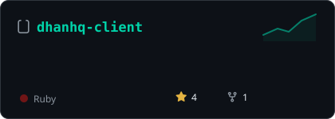
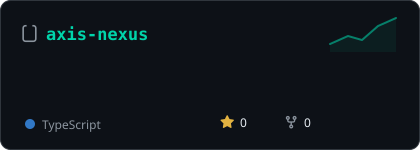
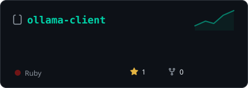
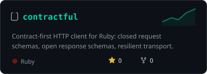
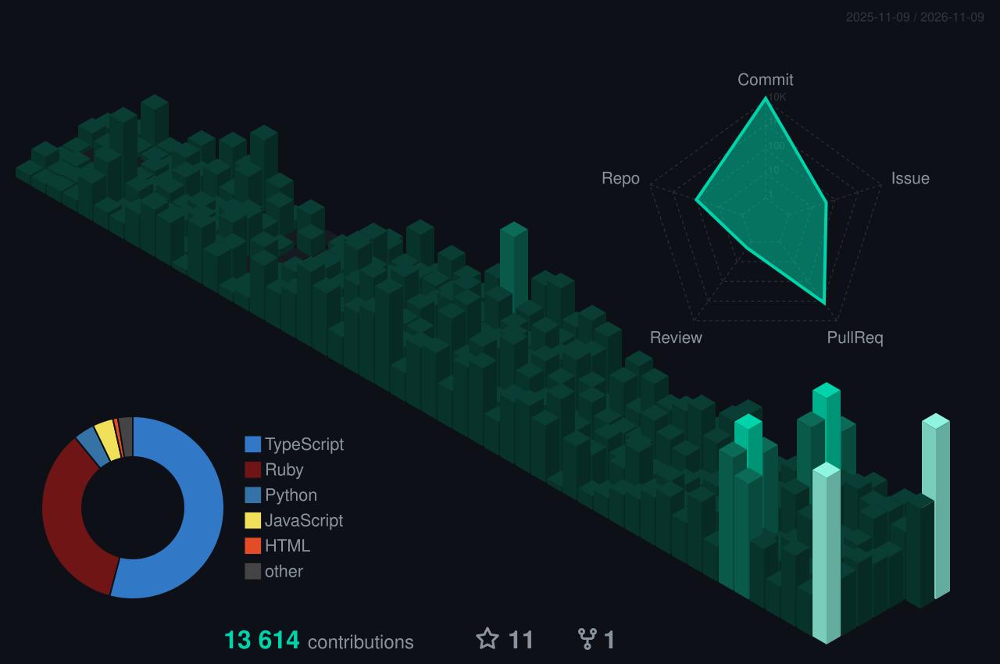

 

# Shubham Taywade

**Software engineer building production-minded trading infrastructure, AI agents, and developer tools.**

*I turn complex APIs and workflows into systems people can build on — across TypeScript, Ruby, and Python.*

  

---

## 🚀 What I’m building

<table>
<tr>
<td width="50%" valign="top">

### 🤖 Nexum

**Autonomous software engineering, from task to pull request.**

An agent runtime, tool gateway, semantic memory, hybrid RAG, multi-agent coordination, and CLI. Currently a developer preview; not yet published to npm.

[Explore Nexum →](https://github.com/shubhamtaywade82/nexum) ·  

</td>
<td width="50%" valign="top">

### 📈 Trading systems & APIs

**Reliable building blocks for market data and execution workflows.**

SDKs and tools for DhanHQ, Binance, and CoinDCX, alongside research, charting, and paper-trading projects.

[Browse trading projects →](https://github.com/shubhamtaywade82?tab=repositories)

</td>
</tr>
</table>

## 📦 Published packages

Download badges are live registry metrics: npm shows **downloads in the last week**; RubyGems shows **all-time downloads**. Counts are provided by Shields.io and may have a short update delay.

### npm · weekly downloads

| Package | What it does | Downloads / week |
|---|---|---|
| [`@nemesis-oss/dhanhq-sdk`](https://www.npmjs.com/package/@nemesis-oss/dhanhq-sdk) | TypeScript SDK for DhanHQ v2: REST, WebSocket, options analytics, and MCP tools |  |
| [`@nemesis-oss/ollama-sdk`](https://www.npmjs.com/package/@nemesis-oss/ollama-sdk) | Ollama SDK with tool calling, failover, and provider bridges |  |
| [`@nemesis-oss/binance-sdk`](https://www.npmjs.com/package/@nemesis-oss/binance-sdk) | Binance Spot, Futures, Margin, and Wallet APIs |  |
| [`@nemesis-oss/coindcx-sdk`](https://www.npmjs.com/package/@nemesis-oss/coindcx-sdk) | CoinDCX Spot, Margin, and Futures SDK |  |
| [`@nemesis-oss/agentic-runtime`](https://www.npmjs.com/package/@nemesis-oss/agentic-runtime) | Model-agnostic runtime for agent workflows |  |
| [`@nemesis-oss/devagent-ts`](https://www.npmjs.com/package/@nemesis-oss/devagent-ts) | Terminal coding-agent runtime *(legacy; succeeded by Nexum)* |  |
| [`@nemesis-oss/tg-format`](https://www.npmjs.com/package/@nemesis-oss/tg-format) | Type-safe Telegram message formatting |  |
| [`@nemesis-oss/termina-core`](https://www.npmjs.com/package/@nemesis-oss/termina-core) | Terminal rendering engine |  |
| [`@nemesis-oss/termina-ui`](https://www.npmjs.com/package/@nemesis-oss/termina-ui) | Terminal UI component kit |  |
| [`@nemesis-oss/termina-genui`](https://www.npmjs.com/package/@nemesis-oss/termina-genui) | Generative UI for terminal applications |  |
| [`contractful-ts`](https://www.npmjs.com/package/contractful-ts) | Contract-first HTTP and WebSocket client for TypeScript |  |

### RubyGems · all-time downloads

| Gem | What it does | Total downloads |
|---|---|---|
| [`DhanHQ`](https://rubygems.org/gems/DhanHQ) | Ruby client for Dhan API v2 |  |
| [`ollama-client`](https://rubygems.org/gems/ollama-client) | Contract-driven Ruby client for Ollama |  |
| [`contractful`](https://rubygems.org/gems/contractful) | Contract-first Ruby HTTP client |  |

## ✨ Selected projects

Project cards are generated from repository metadata; details and status can change.

## 🧭 Project map

A guide to the main areas of my work. [See all repositories →](https://github.com/shubhamtaywade82?tab=repositories)

<strong>📊 Trading systems, agents & research</strong>

| Project | Description |
|---|---|
| [vyuha-options-agent](https://github.com/shubhamtaywade82/vyuha-options-agent) | Options execution agent for Indian index markets, using DhanHQ and local models. |
| [options-trading-agent](https://github.com/shubhamtaywade82/options-trading-agent) | Options buying agent for NSE/BSE indices using DhanHQ. |
| [crypto-trading-agent](https://github.com/shubhamtaywade82/crypto-trading-agent) | Binance perpetuals agent with multi-strategy signals and a TUI cockpit. |
| [crypto-agent](https://github.com/shubhamtaywade82/crypto-agent) | Crypto futures system combining a deterministic trading kernel with local-model assistance. |
| [trading-agent-ts](https://github.com/shubhamtaywade82/trading-agent-ts) | Agentic trading system built with Binance and Ollama SDKs. |
| [paper-broker](https://github.com/shubhamtaywade82/paper-broker) | Paper-trading engine on live Binance data with a real-time dashboard. |
| [crypto-futures-paper-engine](https://github.com/shubhamtaywade82/crypto-futures-paper-engine) | Simulated crypto futures trading engine. |
| [market-intelligence](https://github.com/shubhamtaywade82/market-intelligence) | Market-event detection and counterfactual research tools. |
| [quant-research](https://github.com/shubhamtaywade82/quant-research) | Strategy research workspace. |
| [supertrend-bot](https://github.com/shubhamtaywade82/supertrend-bot) | Supertrend trading bot with an optimizer. |

<strong>🔌 SDKs, exchange APIs & integrations</strong>

| Project | Description |
|---|---|
| [dhanhq-sdk](https://github.com/shubhamtaywade82/dhanhq-sdk) | TypeScript SDK for DhanHQ v2 with WebSocket, options analytics, and MCP support. |
| [dhanhq-client](https://github.com/shubhamtaywade82/dhanhq-client) | Ruby client for Dhan API v2, including WebSocket support. |
| [dhanhq-multi](https://github.com/shubhamtaywade82/dhanhq-multi) | DhanHQ real and sandbox client wrapper. |
| [binance-sdk](https://github.com/shubhamtaywade82/binance-sdk) | TypeScript SDK covering Binance Spot, Futures, Margin, and Wallet APIs. |
| [binance-client](https://github.com/shubhamtaywade82/binance-client) | Ruby Binance API client. |
| [coindcx-sdk](https://github.com/shubhamtaywade82/coindcx-sdk) | CoinDCX SDK for Spot, Margin, and Futures. |
| [ollama-sdk](https://github.com/shubhamtaywade82/ollama-sdk) | TypeScript SDK for Ollama and local-model workflows. |
| [ollama-client](https://github.com/shubhamtaywade82/ollama-client) | Contract-driven Ruby client for Ollama. |
| [contractful-ts](https://github.com/shubhamtaywade82/contractful-ts) · [contractful](https://github.com/shubhamtaywade82/contractful) | Contract-first HTTP clients for TypeScript and Ruby. |
| [telegram-sdk](https://github.com/shubhamtaywade82/telegram-sdk) · [telegram-format](https://github.com/shubhamtaywade82/telegram-format) | Telegram SDK and type-safe message formatting tools. |

<strong>🧠 AI agents & developer tooling</strong>

| Project | Description |
|---|---|
| [nexum](https://github.com/shubhamtaywade82/nexum) | Autonomous software-engineering agent, from task to pull request. |
| [agentic-runtime](https://github.com/shubhamtaywade82/agentic-runtime) | Model-agnostic agent runtime with MCP support. |
| [agent-tui](https://github.com/shubhamtaywade82/agent-tui) | Agent terminal UI, CLI, and API with multiple model providers. |
| [agentic-chat](https://github.com/shubhamtaywade82/agentic-chat) | Web playground for a live ReAct agent loop. |
| [ollama-coding-agent](https://github.com/shubhamtaywade82/ollama-coding-agent) | Ollama coding-agent implementations in Ruby and Go. |
| [nodeforge](https://github.com/shubhamtaywade82/nodeforge) | Developer-tool orchestration for IDEs and agents. |
| [railsforge](https://github.com/shubhamtaywade82/railsforge) | Rails-focused editor extension and developer tools. |
| [local-workbench](https://github.com/shubhamtaywade82/local-workbench) | Local-first editor for documents and structured data. |
| [ruby-agent-skills](https://github.com/shubhamtaywade82/ruby-agent-skills) · [node-agent-skills](https://github.com/shubhamtaywade82/node-agent-skills) · [react-agent-skills](https://github.com/shubhamtaywade82/react-agent-skills) | Engineering skill packs for coding agents. |

<strong>📉 Pine Script, charting & market tools</strong>

| Project | Description |
|---|---|
| [pine-ts](https://github.com/shubhamtaywade82/pine-ts) | TypeScript trading runtime inspired by Pine Script v6. |
| [pine-ts-workbench](https://github.com/shubhamtaywade82/pine-ts-workbench) | Charting workbench with live market data. |
| [pineforge-platform](https://github.com/shubhamtaywade82/pineforge-platform) | Pine Script strategy engineering platform. |
| [pine-script-v6-extension](https://github.com/shubhamtaywade82/pine-script-v6-extension) | Tooling for Pine Script v6. |
| [chart-sdk](https://github.com/shubhamtaywade82/chart-sdk) | Broker-agnostic chart SDK. |
| [tradingview-mcp](https://github.com/shubhamtaywade82/tradingview-mcp) | TradingView tools exposed for agent workflows. |
| [multi-resolution-crypto](https://github.com/shubhamtaywade82/multi-resolution-crypto) | Multi-timeframe crypto market-data cockpit. |

## 🧰 Tools I work with

## 📊 The tape

  

  

---

*“The market doesn't care about your feelings. Neither does the compiler.”*

**Open to collaboration** on trading systems, agent infrastructure, SDKs, and developer tooling.

